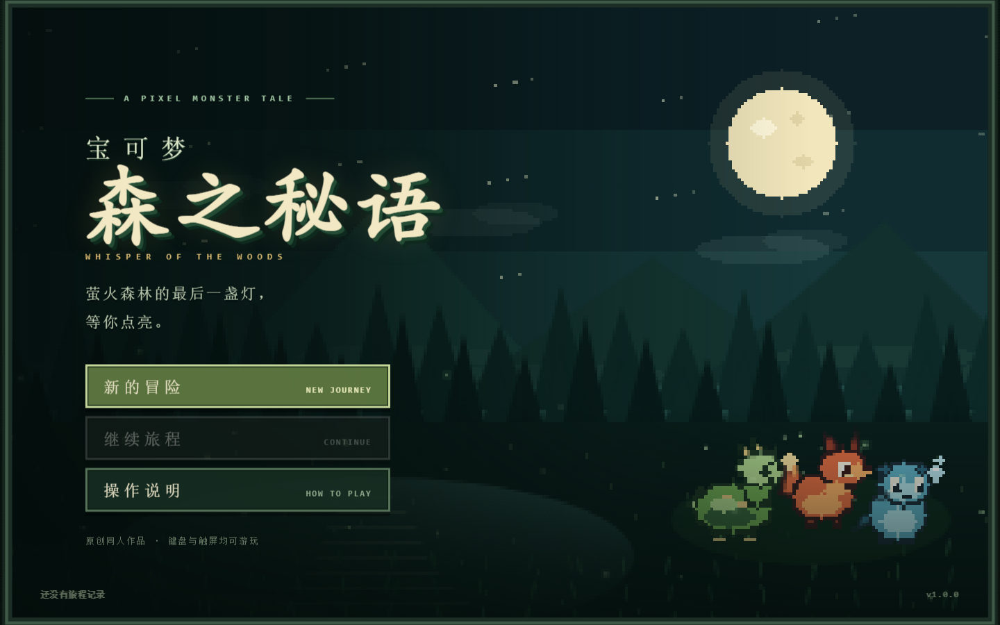
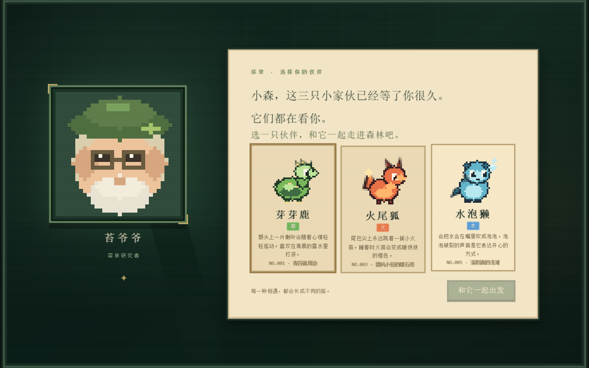
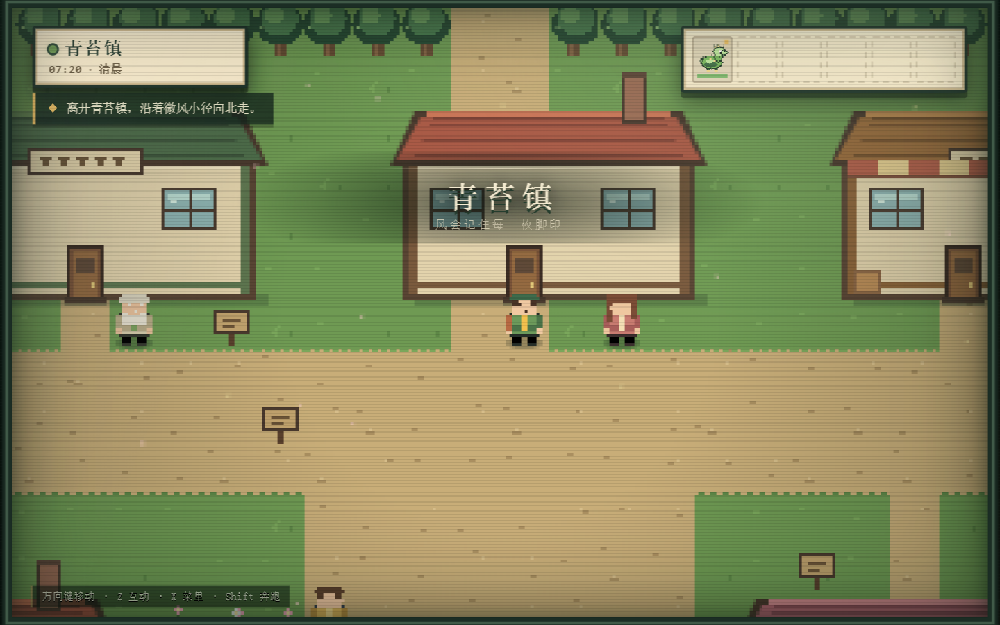
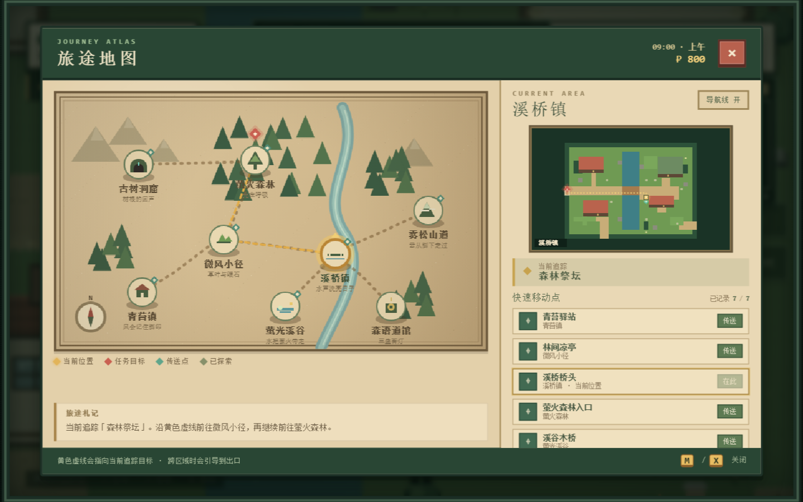
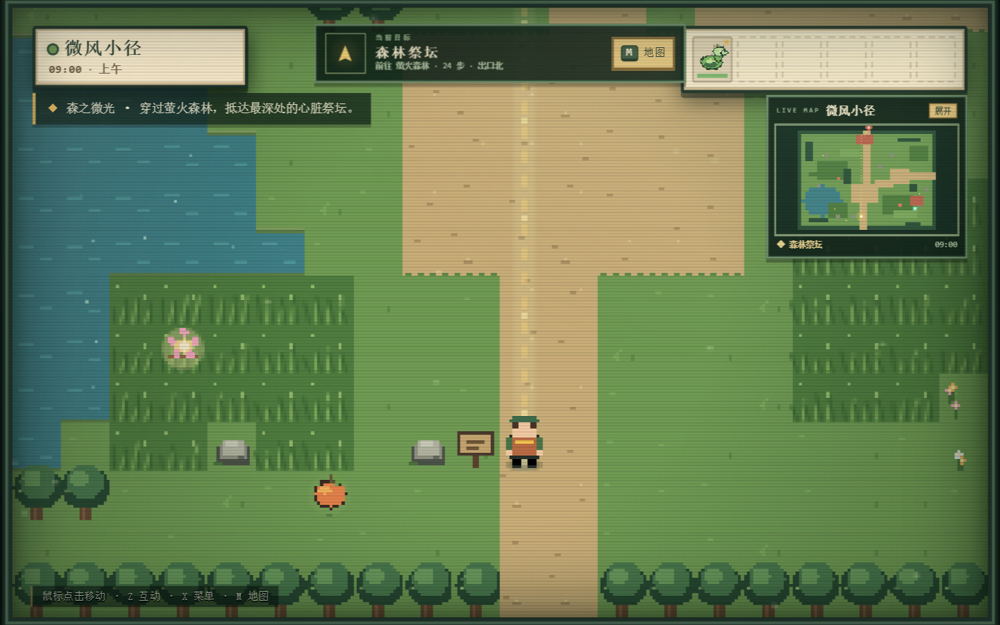
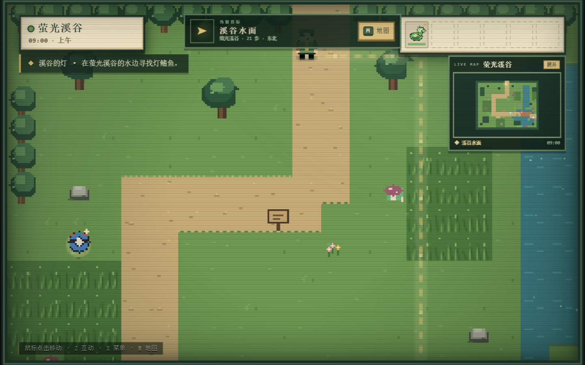
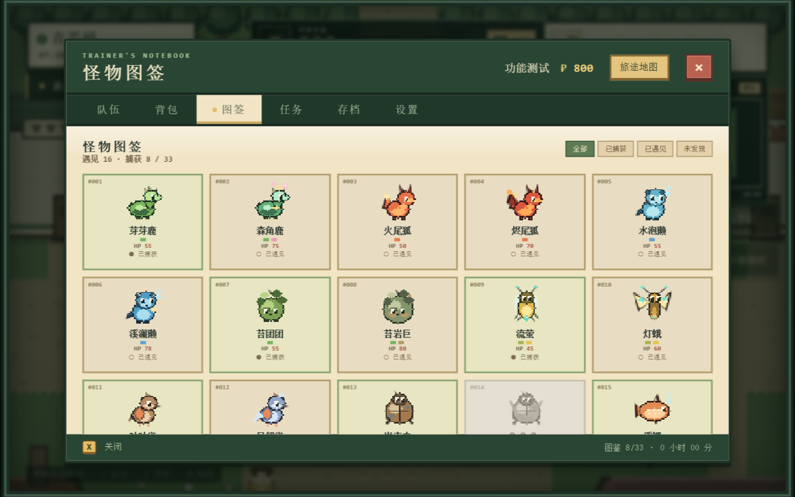
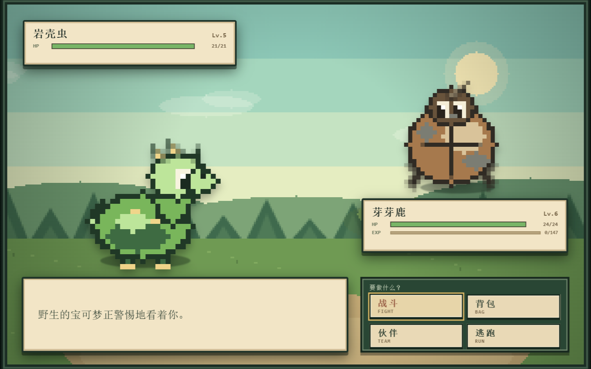
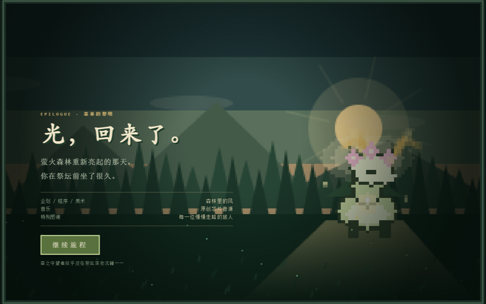

# 宝可梦：森之秘语

> 一款原创同人像素宝可梦小游戏。萤火森林的光正在熄灭，带着你的伙伴穿过微风小径、溪桥镇与古老森林，把黎明重新点亮。











## 如何开始

**最简单的方式：双击 `开始游戏.bat`，或直接用浏览器打开 `index.html`。**

游戏不依赖服务器、不需要安装任何东西，所有画面、音乐与数据都在这几个文件里。推荐使用 Chrome / Edge，并允许页面播放声音。

## 操作

| 操作 | 键盘 | 触屏 |
| --- | --- | --- |
| 移动 | 鼠标点击地面 / 方向键 / WASD | 点击地面 / 左下方向键 |
| 奔跑 | 按住 Shift | — |
| 交谈 / 调查 / 确认 | Z / Enter / 空格 | A |
| 打开旅人手记 / 返回 | X / Esc | B |
| 打开旅途地图 | M | 点击顶部「地图」 |
| 对话继续 | 点击 / Z | 点击对话框 |
| 战斗选择 | 方向键 + Z | 直接点击 |

鼠标点击地面会自动寻路走过去；点击 NPC、木牌、道具或传送点，会走到旁边并自动互动。对话、菜单、商店和战斗也都可以直接点击。

## 内容

- **8 张探索地图**：青苔镇、微风小径、溪桥镇、萤火森林、森语道馆，以及新增的萤光溪谷、雾松山道、古树洞窟。
- **33 种原创宝可梦**：3 只初始伙伴、多组进化链，以及雾隐狐、松果团、灯鳍鱼、穴织蛛、铃兰灵等溪谷 / 山道 / 洞窟专属物种。
- **12 种属性、58 个招式**：属性克制、STAB、要害、命中、PP、能力等级、灼伤 / 中毒 / 麻痹 / 睡眠 / 混乱 / 寄生种子等状态。
- **完整战斗循环**：野生遭遇、训练家对战、捕获、经验、升级、学习招式与进化演出。
- **道馆解谜**：踩亮三盏苔灯，穿过结界挑战馆主苔音，获得森语徽章。
- **主线与支线**：寻找发夹、为乐师收集橙橙果、完成图鉴观察、钓起水属性伙伴、拍下灯鳍鱼、找回松风铃，共 7 条任务。
- **旅途地图**：按 M 打开手绘区域地图与当前区域小地图，查看玩家位置、任务目标、出口与已探索区域。
- **实时小地图**：右上角常驻小地图，实时显示玩家位置、NPC、道具、任务目标、传送点和引导路线；点击即可展开大地图。
- **任务引导线**：世界中的黄色虚线会实时寻路到当前追踪目标；目标在另一张地图时，会先把你带到正确的出口。
- **任务追踪**：在旅人手记的「任务」页可以切换追踪主线或支线，顶部罗盘会显示目标、距离和方向。
- **快速移动点**：青苔驿站、林间凉亭、溪桥桥头、萤火森林入口、溪谷木桥、松风观景台、古树洞口，共 7 个。首次进入区域会自动记录，之后可在旅途中随时传送。
- **怪物图签**：33 种怪物的图签，包含基础体力、Lv.10 / 20 / 30 预计 HP、六项能力、出没地、钓鱼记录、弱点、捕获率、进化关系与常见招式；支持按已捕获 / 已遇见 / 未发现筛选。
- **城镇生活**：商店、驿站治疗、电脑箱、道具使用与出售、图鉴详情、队伍切换。
- **钓鱼**：从阿河处取得旧钓竿，在水边按 Z 垂钓。
- **时间与氛围**：日夜循环、窗口暖光、森林萤火、水面波光、花瓣与落叶。
- **原创芯片音乐**：标题、城镇、道路、森林、道馆、战斗与结局各有循环曲，另有脚步、捕捉、升级等音效。
- **自动与手动存档**：使用浏览器 LocalStorage，切换地图、捕获、战斗结束等时机会自动保存。

## 一点提示

- 属性克制很重要：火克草，草克水，水克火；虫和飞行也克制草。
- 草丛里按 Z 不能直接遇敌，走动才会遇到野生宝可梦。
- 在驿站或妈妈的身边可以让伙伴恢复体力与 PP。
- 打不过就先回镇上补给。输掉对战不会失去伙伴，只会损失一点金币。
- 迷路时按 M：左侧是区域路线图，右侧是当前区域小地图。点击已记录的传送点即可快速移动。
- 小地图就在右上角，点击它会直接打开完整地图；它和世界引导线都会实时更新。
- 如果不想看世界中的虚线，可以在「设置」或地图右上角关闭导航线；顶部罗盘仍会保留方向提示。
- 想看某只怪物有多少血、在哪里出没，打开旅人手记的「图签」页。
- 通关后，森林祭坛深处还有一道沉睡的光。

## 文件结构

```
index.html          页面入口
css/style.css       复古像素界面、战斗、菜单与响应式布局
js/data.js          地图、宝可梦、招式、道具、NPC 与剧情数据
js/art.js           宝可梦、角色、头像与道具的程序化像素美术
js/render.js        地图、建筑、环境粒子与战斗背景渲染
js/audio.js         原创芯片音乐与音效引擎
js/engine.js        状态、移动、地图、队伍、任务、传送点与存档
js/guide.js         任务目标、跨地图寻路、BFS 引导线与区域路线
js/battle.js        回合制战斗、捕获、经验与进化
js/ui.js            标题、序章、对话、菜单、商店、地图与结局
js/main.js          启动、输入、舞台缩放与渲染循环
```

## 说明

- 这是非官方、非商业的原创同人作品，不包含任何官方游戏素材；所有宝可梦、角色、地图与音乐均为本项目原创。
- 存档保存在当前浏览器的 LocalStorage 中（键名 `pkm_forest_whisper_save_v1`），清除浏览器数据会一并清除存档。
- 如果浏览器限制本地文件的存储或音频，可以在此目录启动一个静态服务器再访问 `index.html`。

祝你在森林里慢慢走。
